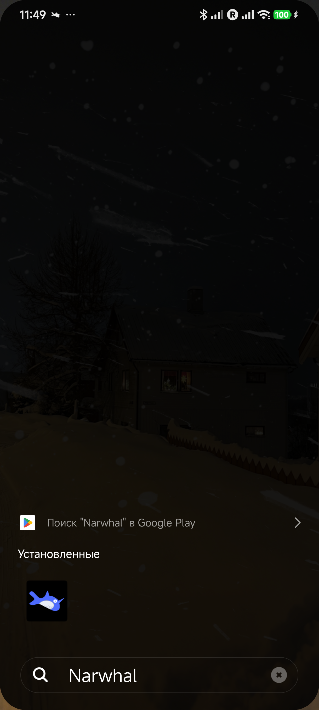
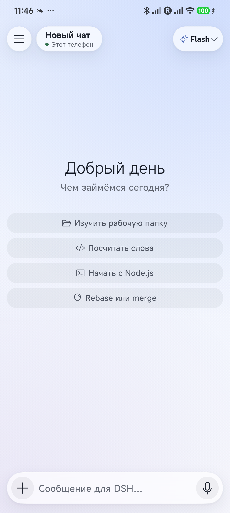
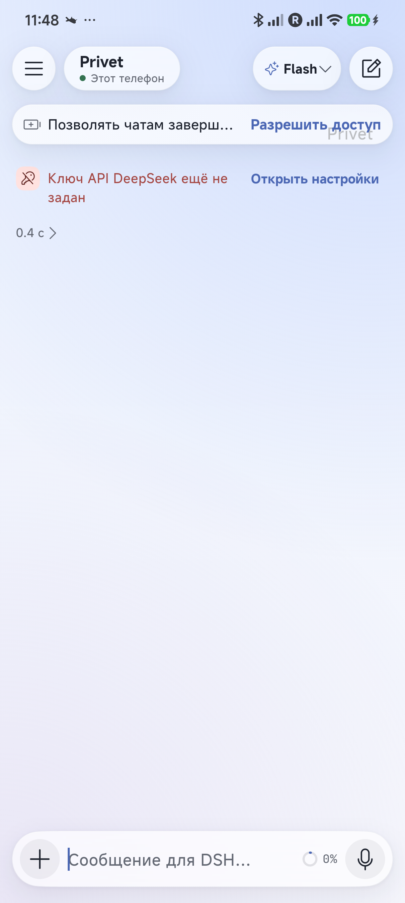
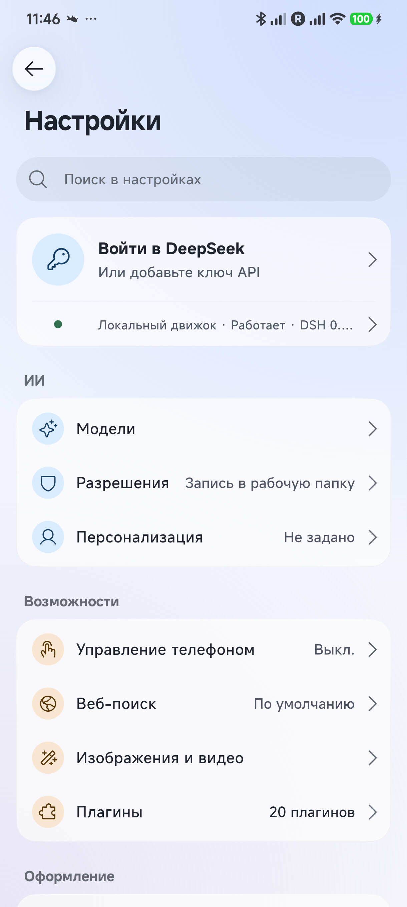
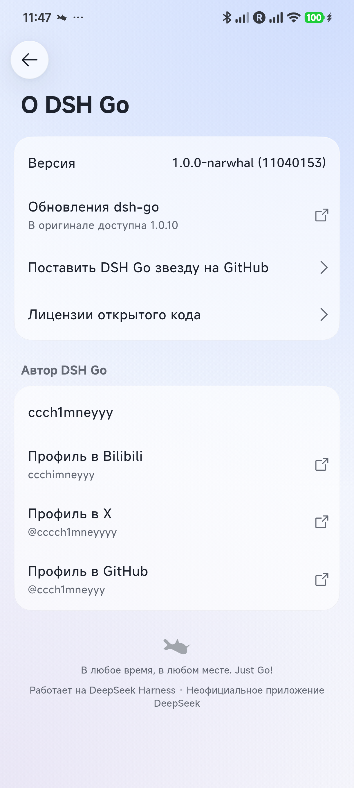
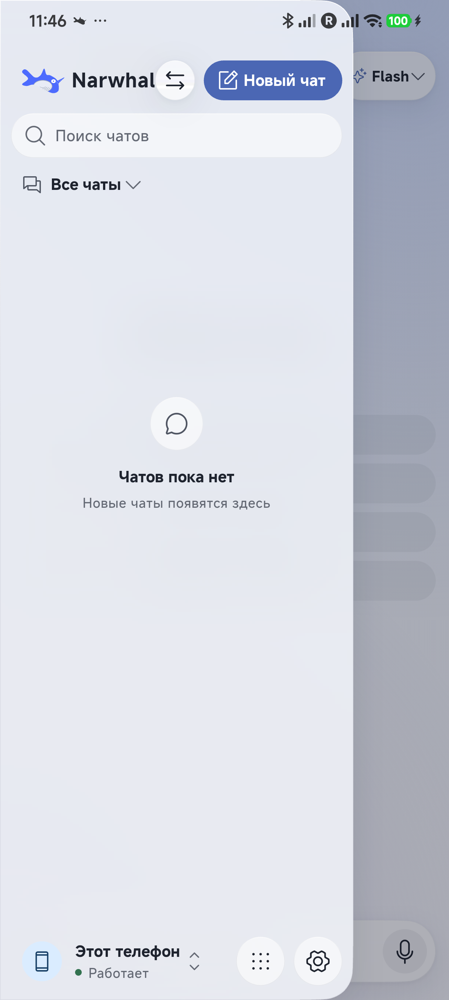
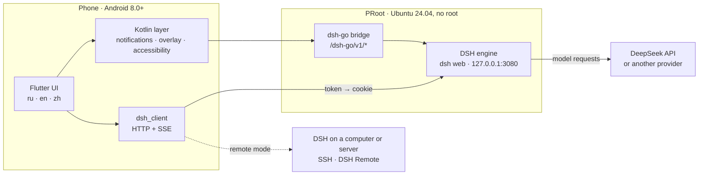
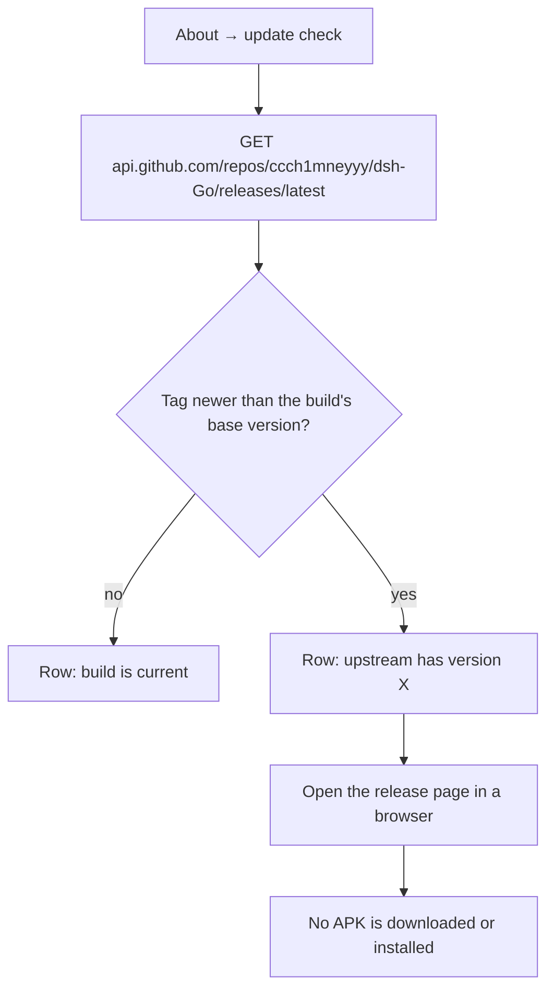

# 🐋 Narwhal — DeepSeek Harness in your pocket

<p align="center"></p>

**An unofficial Android client for DeepSeek Harness: the DSH engine runs on the phone itself, or on your computer or server as a remote host.**

<p align="center"><a href="README.md">Русский</a> · <b>English</b></p>

<p align="center">
  <a href="LICENSE"></a>
  <a href="#install"></a>
  <a href="#build-from-source"></a>
  <a href="#features"></a>
  <a href="https://github.com/rukazax/narwhal/releases"></a>
</p>

## What it is

Narwhal is an Android shell for DeepSeek Harness: a Flutter interface plus its own Linux runtime. The runtime unpacks into the app's private storage and starts the DSH engine under PRoot — no root and no Termux. The same interface can also point at a remote host, leaving the phone as the screen while the work happens on your computer or server.

The project is unofficial and not connected to DeepSeek. Narwhal is a fork of [ccch1mneyyy/dsh-Go](https://github.com/ccch1mneyyy/dsh-Go) (commit `28d43f89`); the engine is the open-source [DeepSeek Harness](https://github.com/deepseek-ai/deepseek-harness). The code in this repository is AGPL-3.0. Layers and trust boundaries are described in [ARCHITECTURE.md](docs/narwhal/ARCHITECTURE.md).

## Features

**Russian is a full third interface language.** Shell strings live in separate ARB files and Android system strings in `values-ru`; English is never substituted for a missing translation. The language sits next to System, Chinese and English and covers the interface, notifications and the floating overlay.

| Feature | What it gives you |
| --- | --- |
| 🐋 **Engine on the phone** | The full DSH in an Ubuntu userland under PRoot: chats, tools, files and workspaces — with no server, no root and no Termux. |
| 🧠 **Chat with the engine** | Models and providers, thinking, tool calls, approvals and questions; chat export and share cards. |
| 🔌 **Remote hosts** | The same interface against DSH on a computer or server: SSH, or DSH Remote with encryption and LAN/P2P → TURN → Relay routes. |
| 📱 **Phone control** | The engine reads the screen, taps and types for your task — with confirmations, a stop button and a floating bar. |
| 🎨 **Themes and icons** | Six colors and your own wallpaper, four app icons, three feature-icon styles, a custom launch screen. |
| 🔒 **Privacy** | No third-party trackers; anonymous stats are disclosed before the first send and turned off with one switch. |
| 🧩 **Plugins and community** | A plugin market with native cards and panels, an SDK with examples, a community page. |
| ⚡ **Adaptive layout** | Layouts for foldables and tablets: a persistent sidebar, centered content, a keyboard that does not squeeze the page. |

> **Pets.** The mechanics, sizes, quiet mode and floating pet are in the build, but **no mascot packs are bundled**: the picker shows only "None". The original's brand art is not part of this fork — see [ASSETS.md](ASSETS.md).

## Screenshots

| Home | Chat | Settings |
| :---: | :---: | :---: |
| <br><sub>Home (Russian UI): chats, hosts, engine state.</sub> | <br><sub>Chat with the local engine: steps fold into one line.</sub> | <br><sub>Settings (Russian UI): search and groups.</sub> |

| About | Drawer | Icon |
| :---: | :---: | :---: |
| <br><sub>About: version, licenses, upstream update check.</sub> | <br><sub>Drawer: mark, wordmark, chats.</sub> | <br><sub>Narwhal icon: adaptive and monochrome.</sub> |

## How it works



- **UI ↔ engine.** The Flutter shell talks to the engine over HTTP and SSE through `packages/dsh_client`. The engine prints a launch token to stdout, the app exchanges it for a cookie and does not keep the token in URLs afterwards.
- **Runtime.** The archive unpacks into the app's private storage on first launch, its integrity is verified before start, and `dsh web` listens on `127.0.0.1:3080` only.
- **PRoot.** The Ubuntu userland and Node.js run in user space: the Android kernel is not rooted, and root inside the rootfs does not reach outside it.
- **Native layer.** Kotlin owns the foreground service, notifications, overlay and accessibility service; the `/dsh-go/v1/*` bridge serves native plugins their cards and panels.
- **Remote mode.** Instead of the local engine, the client connects over SSH or DSH Remote; the interface and the interaction model stay the same.

### Upstream update check



- The build remembers the upstream version it was based on (currently `1.0.9`) and asks GitHub for the latest release of `ccch1mneyyy/dsh-Go`.
- If the tag is newer, About shows "Upstream has X" and links to the release page. Nothing is downloaded or installed: the signing keys differ, so an upstream APK could not be installed over this build anyway.
- The check only reports a newer upstream version. It does not modify the installed app or launch an installer.

## Install

Android 8.0 (API 26) or later. Ready APKs are on the [Releases page](https://github.com/rukazax/narwhal/releases); a regular 64-bit phone needs the **arm64** package, x64 is for emulators only. The repository does not ship through Google Play: this is a sideload build.

1. Download the APK on the phone and allow installs from that source when the system asks.
2. On first launch, choose where DSH runs: **on this phone** or **on a remote host**.
3. For the local mode, install the runtime. It unpacks on first launch and takes about **1 GB**; unpacking takes a while.
4. Set up a model and a provider key, then start chatting.

If you only connect to a computer or server, the phone does not need the runtime. Phone control works with the local engine only and needs accessibility and notification permissions.

## Build from source

The build targets Linux x86_64; on Windows it is convenient to run it in WSL2. You need Bash, Git, curl, tar, unzip, xz, Python 3, zstd and the usual GNU tools. Tool versions are pinned by `tooling/setup-toolchain.sh` and CI: **Flutter 3.47.7**, Dart `^3.13.5`, **JDK 17**, **Android SDK 36** and an NDK (installed by the script).

```bash
git clone https://github.com/rukazax/narwhal.git
cd narwhal

bash tooling/setup-toolchain.sh
source tooling/env.sh
flutter --version
java -version

bash runtime/build-runtime.sh arm64-v8a
bash tooling/build-apk.sh -f arm64
```

The APK lands in `app/build/app/outputs/flutter-apk/app-arm64-release.apk`. For an emulator, build the `x86_64` runtime first, then run `bash tooling/build-apk.sh -f x64`. `tooling/build-apk.sh` stamps `versionCode` from the build minute; `app/pubspec.yaml` holds only the version name, and its `+1` is a placeholder.

Without `app/android/key.properties`, a release build is signed with the debug key: it installs on a test device but not over a build signed with another key. Keys and `key.properties` are never committed.

To make a build behave like the fork rather than the original, pass its base version and turn off self-update of the other APK:

```bash
bash tooling/build-apk.sh -f arm64 -- \
  --dart-define=DSH_SELF_UPDATE=false \
  --dart-define=UPSTREAM_BASE_VERSION=1.0.9
```

## Tests

```bash
(cd app && flutter pub get && flutter analyze && flutter test)
(cd packages/dsh_client && dart pub get && dart analyze && dart test)
(cd packages/dsh_remote && dart pub get && dart analyze && dart test)
node --test runtime/tests/*.test.mjs
```

Goldens are platform-sensitive: update and check them on Linux (WSL), not on Windows, where fonts and rasterization differ. CI runs the same commands on `ubuntu-24.04`; a green CI does not replace a real-phone check, especially for PRoot, direct start and phone control.

## Privacy

- **No third-party trackers.** There are no ad or analytics SDKs in the app; the network is the engine, the model provider you chose, and release checks.
- **Anonymous stats.** On by default; the first launch discloses what is collected, and the switch can be turned off right there. It sends app and Android versions, CPU architecture, phone maker (not model), language, engine start mode and daily action counts — never accounts, keys, chats, files or host addresses. A random ID rotates every 90 days and is deleted with the counters when you switch it off.
- **Chat logs are separate.** The "Upload chat logs to DeepSeek" switch appears only where the host supports it and is unrelated to anonymous stats.
- **Engine telemetry.** OpenTelemetry in the engine is feedback-only: review events, without the text of your conversations.
- **Local and links.** The web interface on `127.0.0.1` accepts the app's own requests only. Share links are end-to-end encrypted, but the key is in the link: anyone who has the link can read the content. SSH keys and passwords stay on the phone.

## License and credits

The code in this repository is [AGPL-3.0](LICENSE); `sdk/` and `examples/` are **MIT**. The [DeepSeek Harness](https://github.com/deepseek-ai/deepseek-harness) engine is MIT, © DeepSeek. Narwhal is a modified version of [DSH Go](https://github.com/ccch1mneyyy/dsh-Go) (AGPL-3.0), based on commit `28d43f89`; what changed is recorded in [NOTICE](NOTICE).

The original's mascots and brand art (Deepy, the whale girl, the tail animation, README images) are **not** part of this fork; the list is in [ASSETS.md](ASSETS.md). Third-party components and their licenses are in [THIRD_PARTY_NOTICES.md](THIRD_PARTY_NOTICES.md).

**Trademarks.** "DeepSeek" and the DeepSeek logo belong to DeepSeek. Narwhal is unofficial, not affiliated with DeepSeek and does not represent it. The Narwhal name and artwork belong to this fork, not to upstream.

Built and maintained by [rukazax](https://github.com/rukazax) (Konstantin Aleksandrovich Yeryomin, Moscow). Bugs and ideas go to [Issues](https://github.com/rukazax/narwhal/issues); report vulnerabilities privately as described in [SECURITY.en.md](SECURITY.en.md).

<sub>Build: <b>RUKAZAX</b> · Narwhal is unofficial — use it at your own risk.</sub>
