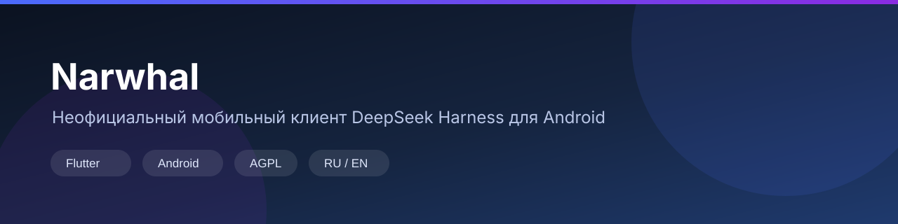
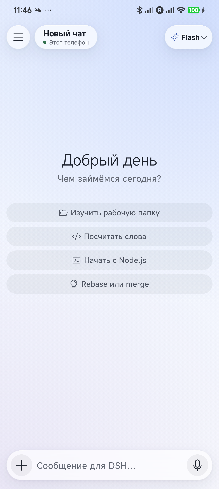
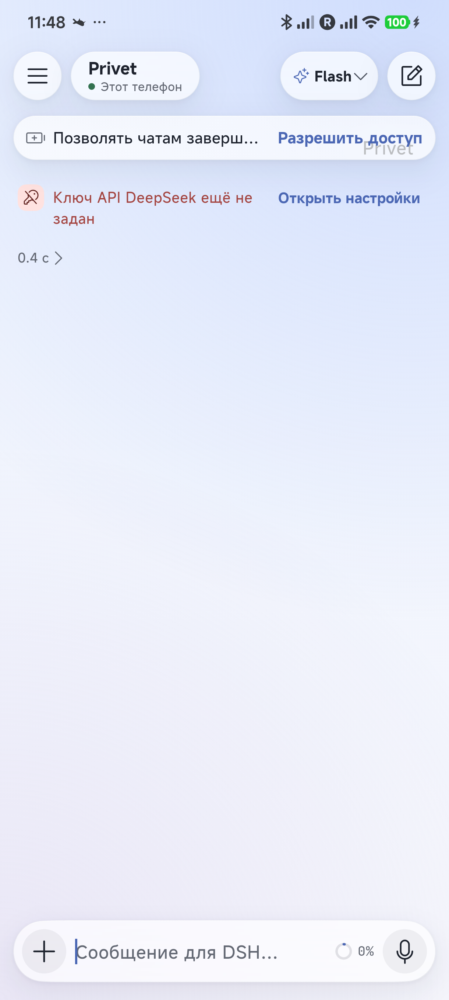
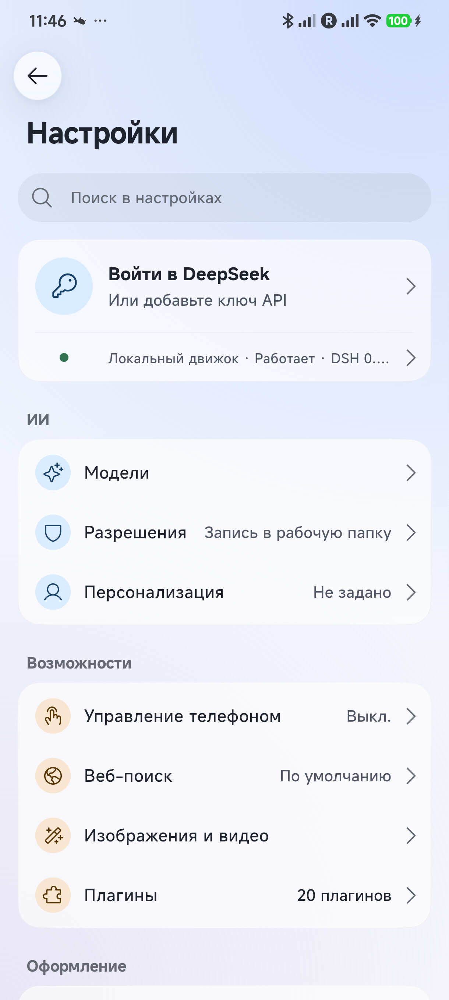
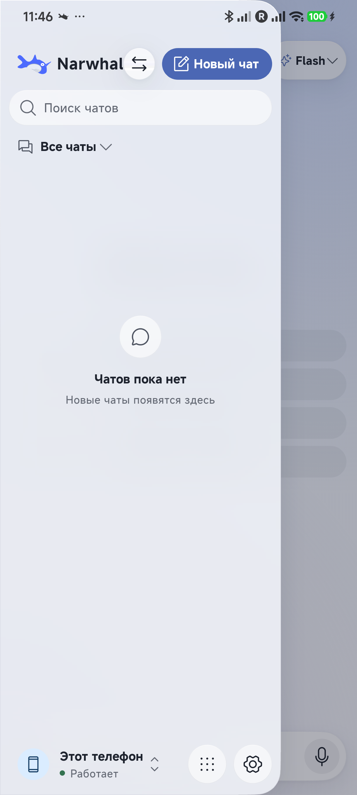
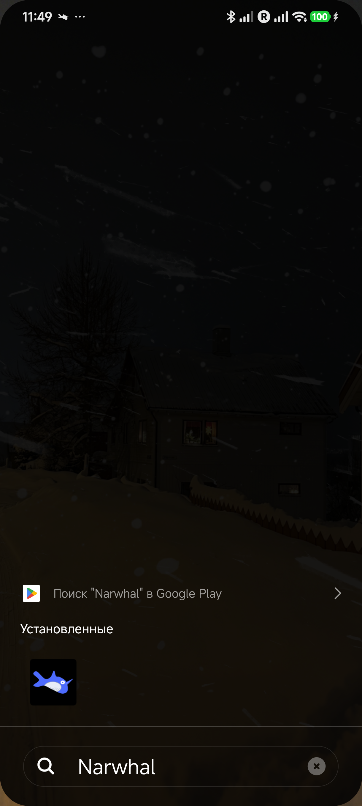
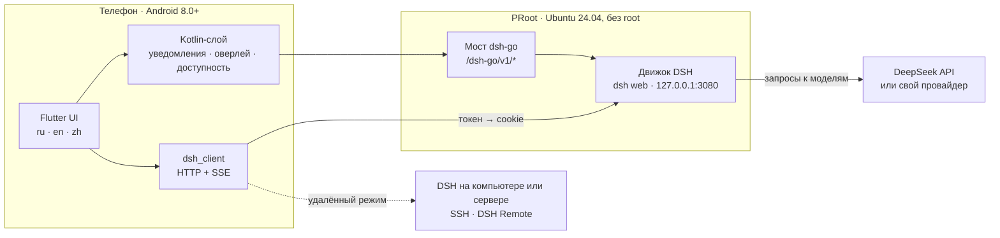
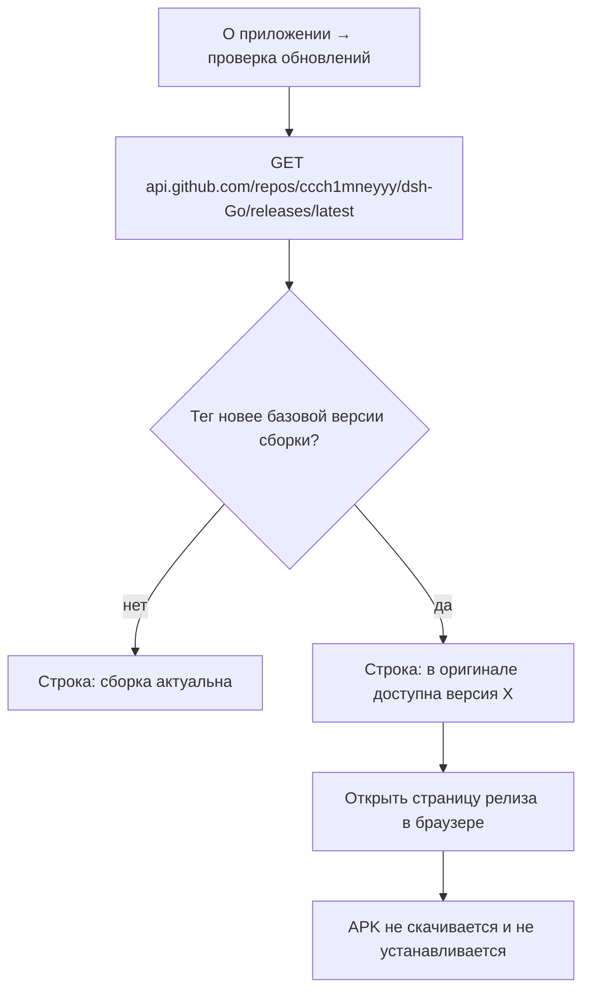
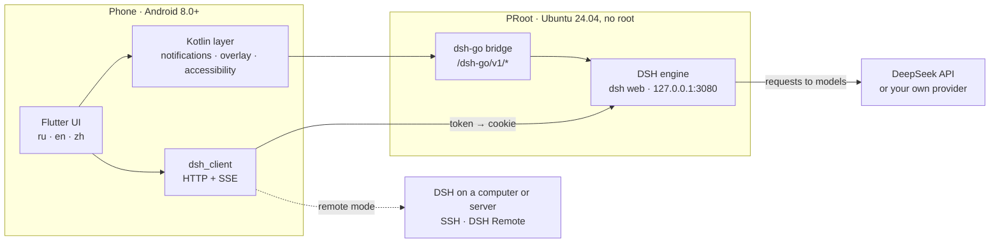
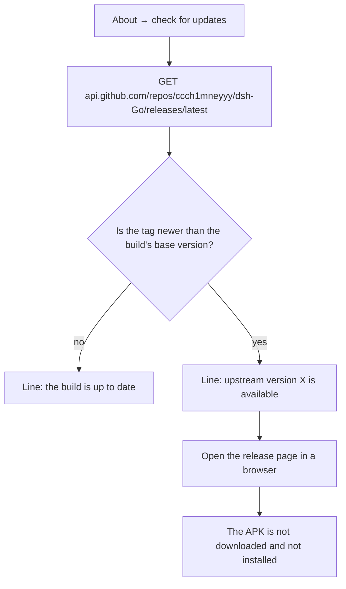

**← [Все проекты · All projects](https://github.com/rukazax?tab=repositories)**

<div align="center">
  
</div>

# 🐋 Narwhal — DeepSeek Harness в кармане

**RU** · [English](#english)

<div align="center">

[](https://github.com/rukazax)
[](#установка)
[](#сборка-из-исходников)
[](#возможности)
[](https://github.com/rukazax/narwhal/releases)
[](LICENSE)

</div>

> **Неофициальный Android-клиент DeepSeek Harness: движок DSH работает прямо на телефоне, а с удалённым хостом — на вашем компьютере или сервере.** Без root и Termux, интерфейс — русский и английский.

| Раздел | О чём |
| --- | --- |
| 📖 [Что это](#что-это) | Слои проекта, форк dsh-Go и границы доверия |
| ✨ [Возможности](#возможности) | Движок на телефоне, чат, удалённые хосты, управление телефоном |
| 📸 [Скриншоты](#скриншоты) | Главный экран, чат, настройки, иконка |
| ⚙️ [Как это работает](#как-это-работает) | Архитектура, PRoot, проверка обновлений оригинала |
| 📲 [Установка](#установка) | APK и первый запуск |
| 🛠 [Сборка из исходников](#сборка-из-исходников) | Тулчейн и команды сборки |
| 🧪 [Тесты](#тесты) | Анализ и тесты пакетов |
| 🔒 [Приватность](#приватность) | Трекеры, анонимная статистика, журналы |
| ⚖️ [Лицензия и благодарности](#лицензия-и-благодарности) | AGPL-3.0, MIT-компоненты, товарные знаки |

---

## Что это

Narwhal — Android-оболочка для DeepSeek Harness: Flutter-интерфейс плюс собственный Linux-рантайм. Рантайм распаковывается в приватную папку приложения и запускает движок DSH под PRoot — без root и без Termux. Тому же интерфейсу можно указать удалённый хост: тогда телефон остаётся экраном, а всё считается на компьютере или сервере.

Проект неофициальный и не связан с DeepSeek. Narwhal — форк [ccch1mneyyy/dsh-Go](https://github.com/ccch1mneyyy/dsh-Go) (коммит `28d43f89`); движок — открытый [DeepSeek Harness](https://github.com/deepseek-ai/deepseek-harness). Код этого репозитория — AGPL-3.0. Подробности о слоях и границах доверия — в [ARCHITECTURE.md](docs/narwhal/ARCHITECTURE.md).

## Возможности

**Русский — полноценный третий язык интерфейса.** Строки оболочки лежат в отдельных ARB-файлах, системные строки Android — в `values-ru`; английский не подставляется вместо перевода. Язык переключается рядом с системным, китайским и английским и покрывает интерфейс, уведомления и плавающий оверлей.

| Возможность | Что это даёт |
| --- | --- |
| 🐋 **Движок на телефоне** | Полный DSH в Ubuntu-окружении под PRoot: чаты, инструменты, файлы и рабочие папки — без сервера, root и Termux. |
| 🧠 **Чат с движком** | Модели и провайдеры, thinking, вызовы инструментов, подтверждения и вопросы; экспорт чата и share-карточки. |
| 🔌 **Удалённые хосты** | Тот же интерфейс к DSH на компьютере или сервере: SSH или DSH Remote с шифрованием и маршрутами LAN/P2P → TURN → Relay. |
| 📱 **Управление телефоном** | Движок читает экран, нажимает и печатает по вашей задаче — с подтверждениями, стоп-кнопкой и плавающей панелью. |
| 🎨 **Темы и иконки** | Шесть цветов и свои обои, четыре набора иконок, три стиля функциональных иконок, своя заставка. |
| 🔒 **Приватность** | Никаких сторонних трекеров; анонимная статистика показывается до первой отправки и выключается одним переключателем. |
| 🧩 **Плагины и сообщество** | Магазин плагинов с нативными карточками и панелями, SDK и примеры, страница сообщества. |
| ⚡ **Адаптивная вёрстка** | Раскладка для складных телефонов и планшетов: боковая панель, центрированный контент, клавиатура не ломает экран. |

> **Питомцы.** Механика, размеры, «тихий режим» и плавающий питомец в сборке есть, но **наборов-маскотов нет**: в списке остаётся только «Не показывать». Бренд-арт оригинала в fork не входит — см. [ASSETS.md](ASSETS.md).

## Скриншоты

| Главная | Чат | Настройки |
| :---: | :---: | :---: |
| <br><sub>Главная: чаты, хосты, состояние движка.</sub> | <br><sub>Чат с локальным движком: шаги сворачиваются в строку.</sub> | <br><sub>Настройки: поиск и разделы.</sub> |

| О приложении | Ящик | Иконка |
| :---: | :---: | :---: |
| <br><sub>О приложении: версия, лицензии, проверка обновлений оригинала.</sub> | <br><sub>Ящик: знак, название, чаты.</sub> | <br><sub>Иконка Narwhal: адаптивная и monochrome.</sub> |

## Как это работает



- **UI ↔ движок.** Flutter-оболочка говорит с движком по HTTP и SSE через `packages/dsh_client`. Токен запуска движок печатает в stdout, приложение сразу меняет его на cookie и дальше не носит токен в URL.
- **Рантайм.** Архив распаковывается в приватную папку приложения при первом запуске, целостность проверяется до старта, `dsh web` слушает только `127.0.0.1:3080`.
- **PRoot.** Ubuntu-окружение и Node.js работают в user-space: ядро Android не рутуется, а root внутри rootfs не выходит наружу.
- **Нативный слой.** Kotlin держит foreground-сервис, уведомления, оверлей и службу доступности; мост `/dsh-go/v1/*` отдаёт нативным плагинам их карточки и панели.
- **Удалённый режим.** Вместо локального движка клиент подключается по SSH или DSH Remote; интерфейс и модель взаимодействия те же.

### Проверка обновлений оригинала



- Сборка помнит версию оригинала, с которой сделана (сейчас `1.0.9`), и спрашивает у GitHub последний релиз `ccch1mneyyy/dsh-Go`.
- Если тег новее, в «О приложении» появляется строка «В оригинале доступна X» и переход на страницу релиза. Ничего не скачивается и не ставится: подписи разные, установка поверх этой сборки всё равно невозможна.
- Проверка только сообщает о новой версии оригинала. Она не меняет установленное приложение и не запускает установщик.

## Установка

Android 8.0 (API 26) и новее. Готовые APK — на [странице релизов](https://github.com/rukazax/narwhal/releases); для обычного 64-битного телефона нужен пакет **arm64**, x64 — только для эмулятора. Репозиторий не публикуется в Google Play: это сборка для сайдлоада.

1. Скачайте APK на телефон и разрешите установку из этого источника, когда система спросит.
2. При первом запуске выберите, где работает DSH: **на этом телефоне** или **на удалённом хосте**.
3. Для локального режима установите рантайм. Он распаковывается при первом запуске и занимает около **1 ГБ**; распаковка занимает время.
4. Настройте модель и ключ провайдера и начните чат.

Если вы подключаетесь только к компьютеру или серверу, рантайм на телефон ставить не нужно. Управление телефоном работает только с локальным движком и требует разрешений на специальные возможности и уведомления.

## Сборка из исходников

Сборка рассчитана на Linux x86_64; на Windows её удобно запускать в WSL2. Нужны Bash, Git, curl, tar, unzip, xz, Python 3, zstd и обычные GNU-утилиты. Версии инструментов закреплены в `tooling/setup-toolchain.sh` и CI: **Flutter 3.47.7**, Dart `^3.13.5`, **JDK 17**, **Android SDK 36** и NDK (ставится скриптом).

```bash
git clone https://github.com/rukazax/narwhal.git
cd narwhal

bash tooling/setup-toolchain.sh
source tooling/env.sh
flutter --version
java -version

bash runtime/build-runtime.sh arm64-v8a
bash tooling/build-apk.sh -f arm64
```

Готовый APK — `app/build/app/outputs/flutter-apk/app-arm64-release.apk`. Для эмулятора сначала соберите рантайм `x86_64`, затем `bash tooling/build-apk.sh -f x64`. `tooling/build-apk.sh` сам ставит `versionCode` по времени сборки; `app/pubspec.yaml` хранит только версию, её `+1` — заглушка.

Без `app/android/key.properties` release-сборка подписывается debug-ключом: такой APK ставится на тестовое устройство, но не поверх сборки с другим ключом. Ключи и `key.properties` в репозиторий не коммитятся.

Чтобы сборка вела себя как fork, а не как оригинал, ей передают версию-базу и отключают автообновление чужого APK:

```bash
bash tooling/build-apk.sh -f arm64 -- \
  --dart-define=DSH_SELF_UPDATE=false \
  --dart-define=UPSTREAM_BASE_VERSION=1.0.9
```

## Тесты

```bash
(cd app && flutter pub get && flutter analyze && flutter test)
(cd packages/dsh_client && dart pub get && dart analyze && dart test)
(cd packages/dsh_remote && dart pub get && dart analyze && dart test)
node --test runtime/tests/*.test.mjs
```

Голдены чувствительны к платформе: обновляйте и проверяйте их в Linux (WSL), а не на Windows — там расходятся шрифты и растеризация. CI гоняет те же команды на `ubuntu-24.04`; зелёный CI не заменяет проверку на реальном телефоне, особенно для PRoot, прямого запуска и управления телефоном.

## Приватность

- **Никаких сторонних трекеров.** В приложении нет рекламных и аналитических SDK; сеть — это движок, выбранный провайдер моделей и проверка релизов.
- **Анонимная статистика.** Включена по умолчанию; на первом запуске раскрывают состав данных, и переключатель можно сразу выключить. Уходят версии приложения и Android, архитектура, производитель телефона (не модель), язык, способ запуска движка и суточные счётчики действий — без аккаунтов, ключей, чатов, файлов и адресов хостов. Случайный ID меняется каждые 90 дней и удаляется вместе со счётчиками при выключении.
- **Журналы чатов — отдельно.** Переключатель «Отправлять журналы чатов в DeepSeek» показывается только там, где хост это поддерживает, и не связан с анонимной статистикой.
- **Телеметрия движка.** OpenTelemetry в движке работает только для обратной связи: события отзывов, без текста переписки.
- **Локально и по ссылке.** Веб-интерфейс на `127.0.0.1` принимает только обращения самого приложения. Ссылки шаринга шифруются end-to-end, но ключ лежит в ссылке: кто получил ссылку, тот прочитает содержимое. SSH-ключи и пароли остаются на телефоне.

## Лицензия и благодарности

Код этого репозитория — [AGPL-3.0](LICENSE); `sdk/` и `examples/` — **MIT**. Движок [DeepSeek Harness](https://github.com/deepseek-ai/deepseek-harness) — MIT, © DeepSeek. Narwhal — изменённая версия [DSH Go](https://github.com/ccch1mneyyy/dsh-Go) (AGPL-3.0), исходный коммит `28d43f89`; что именно изменено, записано в [NOTICE](NOTICE).

Маскоты и бренд-арт оригинала (Deepy, «кит-девушка», анимации хвоста, картинки README) в fork **не входят**; список — в [ASSETS.md](ASSETS.md). Сторонние компоненты и их лицензии — в [THIRD_PARTY_NOTICES.md](THIRD_PARTY_NOTICES.md).

**Товарные знаки.** «DeepSeek» и логотип DeepSeek принадлежат DeepSeek. Narwhal — неофициальный проект, не аффилирован с DeepSeek и не представляет её. Название и графика Narwhal — этого fork, а не upstream.

Сборка и поддержка — [rukazax](https://github.com/rukazax) (Константин Александрович Ерёмин, Москва). Ошибки и предложения — в [Issues](https://github.com/rukazax/narwhal/issues); уязвимости — приватно, по [SECURITY.md](SECURITY.md).

<sub>Сборка: <b>RUKAZAX</b> · Narwhal неофициальный, используйте на свой риск.</sub>

## English

### What it is

Narwhal is an Android shell for DeepSeek Harness: a Flutter interface plus its own Linux runtime. The runtime unpacks into the app's private folder and runs the DSH engine under PRoot — no root and no Termux. The same interface can be pointed at a remote host: then the phone stays the screen, and everything is computed on your computer or server.

This is an unofficial project, not affiliated with DeepSeek. Narwhal is a fork of [ccch1mneyyy/dsh-Go](https://github.com/ccch1mneyyy/dsh-Go) (commit `28d43f89`); the engine is the open [DeepSeek Harness](https://github.com/deepseek-ai/deepseek-harness). The code of this repository is AGPL-3.0. Layers and trust boundaries are described in [ARCHITECTURE.md](docs/narwhal/ARCHITECTURE.md).

### Features

**Russian is a full third language of the interface.** Shell strings live in separate ARB files, Android system strings — in `values-ru`; English is never substituted for the translation. The language switches next to System, Chinese and English and covers the interface, notifications and the floating overlay.

| Feature | What it gives |
| --- | --- |
| 🐋 **Engine on the phone** | Full DSH in an Ubuntu environment under PRoot: chats, tools, files and working folders — without a server, root or Termux. |
| 🧠 **Chat with the engine** | Models and providers, thinking, tool calls, confirmations and questions; chat export and share cards. |
| 🔌 **Remote hosts** | The same interface against DSH on a computer or server: SSH or DSH Remote with encryption and LAN/P2P → TURN → Relay routes. |
| 📱 **Phone control** | The engine reads the screen, taps and types for your task — with confirmations, a stop button and a floating panel. |
| 🎨 **Themes and icons** | Six colors and your own wallpapers, four icon packs, three styles of functional icons, your own splash screen. |
| 🔒 **Privacy** | No third-party trackers; anonymous statistics are shown before the first send and turn off with a single toggle. |
| 🧩 **Plugins and community** | Plugin store with native cards and panels, an SDK and examples, a community page. |
| ⚡ **Adaptive layout** | Layouts for foldables and tablets: a side panel, centered content, the keyboard does not break the screen. |

> **Pets.** The mechanics, sizes, “quiet mode” and the floating pet exist in the build, but there are **no mascot packs**: the list keeps only “Don't show”. The original's brand art is not part of the fork — see [ASSETS.md](ASSETS.md).

### Screenshots

| Home | Chat | Settings |
| :---: | :---: | :---: |
| <br><sub>Home: chats, hosts, engine state.</sub> | <br><sub>Chat with the local engine: steps collapse into one line.</sub> | <br><sub>Settings: search and sections.</sub> |

| About | Drawer | Icon |
| :---: | :---: | :---: |
| <br><sub>About: version, licenses, upstream update check.</sub> | <br><sub>Drawer: sign, name, chats.</sub> | <br><sub>Narwhal icon: adaptive and monochrome.</sub> |

### How it works



- **UI ↔ engine.** The Flutter shell talks to the engine over HTTP and SSE via `packages/dsh_client`. The engine prints the run token to stdout, the app immediately swaps it for a cookie and never carries the token in URLs afterwards.
- **Runtime.** The archive unpacks into the app's private folder on first launch, integrity is checked before start, and `dsh web` listens only on `127.0.0.1:3080`.
- **PRoot.** The Ubuntu environment and Node.js run in user-space: the Android kernel is not rooted, and root inside the rootfs does not leak outside.
- **Native layer.** Kotlin holds the foreground service, notifications, the overlay and the accessibility service; the `/dsh-go/v1/*` bridge hands native plugins their cards and panels.
- **Remote mode.** Instead of the local engine the client connects over SSH or DSH Remote; the interface and the interaction model are the same.

#### Upstream update check



- The build remembers the upstream version it is based on (currently `1.0.9`) and asks GitHub for the latest release of `ccch1mneyyy/dsh-Go`.
- If the tag is newer, “About” shows the line “Upstream version X is available” and a link to the release page. Nothing is downloaded or installed: the signatures differ, so installing over this build is impossible anyway.
- The check only reports a new upstream version. It does not change the installed app and does not launch an installer.

### Installation

Android 8.0 (API 26) or newer. Ready-made APKs are on the [releases page](https://github.com/rukazax/narwhal/releases); for an ordinary 64-bit phone you need the **arm64** package, x64 is for the emulator only. The app is not published on Google Play: this is a sideload build.

1. Download the APK to the phone and allow installation from this source when the system asks.
2. On first launch choose where DSH runs: **on this phone** or **on a remote host**.
3. For local mode install the runtime. It unpacks on first launch and takes about **1 GB**; unpacking takes a while.
4. Configure the model and the provider key and start chatting.

If you only connect to a computer or server, you do not need the runtime on the phone. Phone control works only with the local engine and requires accessibility and notification permissions.

### Building from source

The build targets Linux x86_64; on Windows it is convenient to run it in WSL2. You need Bash, Git, curl, tar, unzip, xz, Python 3, zstd and the usual GNU tools. Tool versions are pinned in `tooling/setup-toolchain.sh` and CI: **Flutter 3.47.7**, Dart `^3.13.5`, **JDK 17**, **Android SDK 36** and the NDK (installed by the script).

```bash
git clone https://github.com/rukazax/narwhal.git
cd narwhal

bash tooling/setup-toolchain.sh
source tooling/env.sh
flutter --version
java -version

bash runtime/build-runtime.sh arm64-v8a
bash tooling/build-apk.sh -f arm64
```

The finished APK is `app/build/app/outputs/flutter-apk/app-arm64-release.apk`. For the emulator, first build the `x86_64` runtime, then `bash tooling/build-apk.sh -f x64`. `tooling/build-apk.sh` sets `versionCode` from the build time by itself; `app/pubspec.yaml` only keeps the version, its `+1` is a stub.

Without `app/android/key.properties` a release build is signed with the debug key: such an APK installs on a test device, but not over a build with a different key. Keys and `key.properties` are not committed to the repository.

To make the build behave as a fork, not as the original, it is given the base version and auto-update of someone else's APK is disabled:

```bash
bash tooling/build-apk.sh -f arm64 -- \
  --dart-define=DSH_SELF_UPDATE=false \
  --dart-define=UPSTREAM_BASE_VERSION=1.0.9
```

### Tests

```bash
(cd app && flutter pub get && flutter analyze && flutter test)
(cd packages/dsh_client && dart pub get && dart analyze && dart test)
(cd packages/dsh_remote && dart pub get && dart analyze && dart test)
node --test runtime/tests/*.test.mjs
```

Golden tests are platform-sensitive: update and check them in Linux (WSL), not on Windows — fonts and rasterization diverge there. CI runs the same commands on `ubuntu-24.04`; green CI does not replace testing on a real phone, especially for PRoot, direct launch and phone control.

### Privacy

- **No third-party trackers.** The app has no ad or analytics SDKs; the network is the engine, the chosen model provider and the release check.
- **Anonymous statistics.** On by default; the first launch discloses what data is sent, and the toggle can be switched off right away. It sends the app and Android versions, the architecture, the phone manufacturer (not the model), the language, the way the engine was started and daily action counters — no accounts, keys, chats, files or host addresses. A random ID changes every 90 days and is deleted together with the counters when switched off.
- **Chat logs — separate.** The “Send chat logs to DeepSeek” toggle is shown only where the host supports it and is not tied to anonymous statistics.
- **Engine telemetry.** OpenTelemetry in the engine works only for feedback: review events, no conversation text.
- **Local and by link.** The web interface on `127.0.0.1` accepts only requests from the app itself. Sharing links are encrypted end-to-end, but the key lives in the link: whoever gets the link reads the content. SSH keys and passwords stay on the phone.

### License and acknowledgements

The code of this repository is [AGPL-3.0](LICENSE); `sdk/` and `examples/` are **MIT**. The [DeepSeek Harness](https://github.com/deepseek-ai/deepseek-harness) engine is MIT, © DeepSeek. Narwhal is a modified version of [DSH Go](https://github.com/ccch1mneyyy/dsh-Go) (AGPL-3.0), original commit `28d43f89`; what exactly was changed is recorded in [NOTICE](NOTICE).

The original's mascots and brand art (Deepy, the “whale girl”, tail animations, README images) are **not** part of the fork; the list is in [ASSETS.md](ASSETS.md). Third-party components and their licenses are in [THIRD_PARTY_NOTICES.md](THIRD_PARTY_NOTICES.md).

**Trademarks.** “DeepSeek” and the DeepSeek logo belong to DeepSeek. Narwhal is an unofficial project, not affiliated with DeepSeek and does not represent it. The Narwhal name and graphics belong to this fork, not to upstream.

Build and maintenance — [rukazax](https://github.com/rukazax) (Konstantin Aleksandrovich Eryomin, Moscow). Bugs and suggestions — in [Issues](https://github.com/rukazax/narwhal/issues); vulnerabilities — privately, via [SECURITY.md](SECURITY.md).

<sub>Build: <b>RUKAZAX</b> · Narwhal is unofficial, use at your own risk.</sub>

---

#android #flutter #deepseek #deepseek-harness #narwhal #agpl-3.0 #mobile-client #prroot #sideload #ru-en
