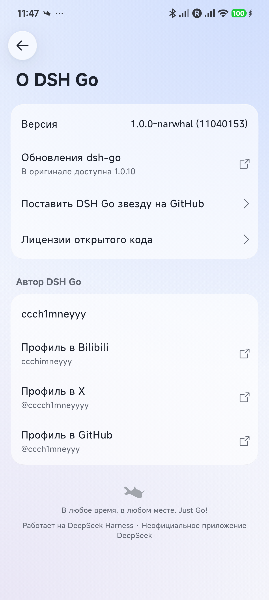
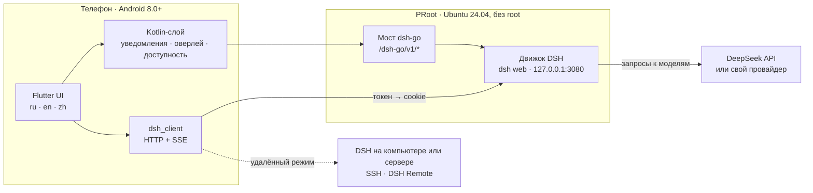
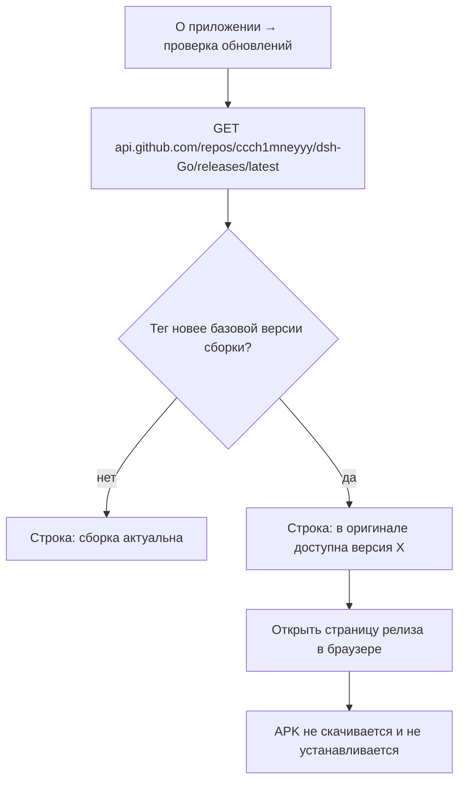

# 🐋 Narwhal — DeepSeek Harness в кармане

<p align="center"></p>

**Неофициальный Android-клиент DeepSeek Harness: движок DSH работает прямо на телефоне, а с удалённым хостом — на вашем компьютере или сервере.**

<p align="center"><b>Русский</b> · <a href="README.en.md">English</a></p>

<p align="center">
  <a href="LICENSE"></a>
  <a href="#установка"></a>
  <a href="#сборка-из-исходников"></a>
  <a href="#возможности"></a>
  <a href="https://github.com/rukazax/narwhal/releases"></a>
</p>

## Что это

Narwhal — Android-оболочка для DeepSeek Harness: Flutter-интерфейс плюс собственный Linux-рантайм. Рантайм распаковывается в приватную папку приложения и запускает движок DSH под PRoot — без root и без Termux. Тому же интерфейсу можно указать удалённый хост: тогда телефон остаётся экраном, а всё считается на компьютере или сервере.

Проект неофициальный и не связан с DeepSeek. Narwhal — форк [ccch1mneyyy/dsh-Go](https://github.com/ccch1mneyyy/dsh-Go) (коммит `28d43f89`); движок — открытый [DeepSeek Harness](https://github.com/deepseek-ai/deepseek-harness). Код этого репозитория — AGPL-3.0. Подробности о слоях и границах доверия — в [ARCHITECTURE.md](docs/narwhal/ARCHITECTURE.md).

## Возможности

**Русский — полноценный третий язык интерфейса.** Строки оболочки лежат в отдельных ARB-файлах, системные строки Android — в `values-ru`; английский не подставляется вместо перевода. Язык переключается рядом с системным, китайским и английским и покрывает интерфейс, уведомления и плавающий оверлей.

| Возможность | Что это даёт |
| --- | --- |
| 🐋 **Движок на телефоне** | Полный DSH в Ubuntu-окружении под PRoot: чаты, инструменты, файлы и рабочие папки — без сервера, root и Termux. |
| 🧠 **Чат с движком** | Модели и провайдеры, thinking, вызовы инструментов, подтверждения и вопросы; экспорт чата и share-карточки. |
| 🔌 **Удалённые хосты** | Тот же интерфейс к DSH на компьютере или сервере: SSH или DSH Remote с шифрованием и маршрутами LAN/P2P → TURN → Relay. |
| 📱 **Управление телефоном** | Движок читает экран, нажимает и печатает по вашей задаче — с подтверждениями, стоп-кнопкой и плавающей панелью. |
| 🎨 **Темы и иконки** | Шесть цветов и свои обои, четыре набора иконок, три стиля функциональных иконок, своя заставка. |
| 🔒 **Приватность** | Никаких сторонних трекеров; анонимная статистика показывается до первой отправки и выключается одним переключателем. |
| 🧩 **Плагины и сообщество** | Магазин плагинов с нативными карточками и панелями, SDK и примеры, страница сообщества. |
| ⚡ **Адаптивная вёрстка** | Раскладка для складных телефонов и планшетов: боковая панель, центрированный контент, клавиатура не ломает экран. |

> **Питомцы.** Механика, размеры, «тихий режим» и плавающий питомец в сборке есть, но **наборов-маскотов нет**: в списке остаётся только «Не показывать». Бренд-арт оригинала в fork не входит — см. [ASSETS.md](ASSETS.md).

## Скриншоты

| Главная | Чат | Настройки |
| :---: | :---: | :---: |
| <br><sub>Главная: чаты, хосты, состояние движка.</sub> | <br><sub>Чат с локальным движком: шаги сворачиваются в строку.</sub> | <br><sub>Настройки: поиск и разделы.</sub> |

| О приложении | Складной экран | Иконка |
| :---: | :---: | :---: |
| <br><sub>О приложении: версия, лицензии, проверка обновлений оригинала.</sub> | <br><sub>Складной экран и планшет: постоянная боковая панель.</sub> | <br><sub>Иконка Narwhal: адаптивная и monochrome.</sub> |

## Как это работает



- **UI ↔ движок.** Flutter-оболочка говорит с движком по HTTP и SSE через `packages/dsh_client`. Токен запуска движок печатает в stdout, приложение сразу меняет его на cookie и дальше не носит токен в URL.
- **Рантайм.** Архив распаковывается в приватную папку приложения при первом запуске, целостность проверяется до старта, `dsh web` слушает только `127.0.0.1:3080`.
- **PRoot.** Ubuntu-окружение и Node.js работают в user-space: ядро Android не рутуется, а root внутри rootfs не выходит наружу.
- **Нативный слой.** Kotlin держит foreground-сервис, уведомления, оверлей и службу доступности; мост `/dsh-go/v1/*` отдаёт нативным плагинам их карточки и панели.
- **Удалённый режим.** Вместо локального движка клиент подключается по SSH или DSH Remote; интерфейс и модель взаимодействия те же.

### Проверка обновлений оригинала



- Сборка помнит версию оригинала, с которой сделана (сейчас `1.0.9`), и спрашивает у GitHub последний релиз `ccch1mneyyy/dsh-Go`.
- Если тег новее, в «О приложении» появляется строка «В оригинале доступна X» и переход на страницу релиза. Ничего не скачивается и не ставится: подписи разные, установка поверх этой сборки всё равно невозможна.
- Проверка только сообщает о новой версии оригинала. Она не меняет установленное приложение и не запускает установщик.

## Установка

Android 8.0 (API 26) и новее. Готовые APK — на [странице релизов](https://github.com/rukazax/narwhal/releases); для обычного 64-битного телефона нужен пакет **arm64**, x64 — только для эмулятора. Репозиторий не публикуется в Google Play: это сборка для сайдлоада.

1. Скачайте APK на телефон и разрешите установку из этого источника, когда система спросит.
2. При первом запуске выберите, где работает DSH: **на этом телефоне** или **на удалённом хосте**.
3. Для локального режима установите рантайм. Он распаковывается при первом запуске и занимает около **1 ГБ**; распаковка занимает время.
4. Настройте модель и ключ провайдера и начните чат.

Если вы подключаетесь только к компьютеру или серверу, рантайм на телефон ставить не нужно. Управление телефоном работает только с локальным движком и требует разрешений на специальные возможности и уведомления.

## Сборка из исходников

Сборка рассчитана на Linux x86_64; на Windows её удобно запускать в WSL2. Нужны Bash, Git, curl, tar, unzip, xz, Python 3, zstd и обычные GNU-утилиты. Версии инструментов закреплены в `tooling/setup-toolchain.sh` и CI: **Flutter 3.47.7**, Dart `^3.13.5`, **JDK 17**, **Android SDK 36** и NDK (ставится скриптом).

```bash
git clone https://github.com/rukazax/narwhal.git
cd narwhal

bash tooling/setup-toolchain.sh
source tooling/env.sh
flutter --version
java -version

bash runtime/build-runtime.sh arm64-v8a
bash tooling/build-apk.sh -f arm64
```

Готовый APK — `app/build/app/outputs/flutter-apk/app-arm64-release.apk`. Для эмулятора сначала соберите рантайм `x86_64`, затем `bash tooling/build-apk.sh -f x64`. `tooling/build-apk.sh` сам ставит `versionCode` по времени сборки; `app/pubspec.yaml` хранит только версию, её `+1` — заглушка.

Без `app/android/key.properties` release-сборка подписывается debug-ключом: такой APK ставится на тестовое устройство, но не поверх сборки с другим ключом. Ключи и `key.properties` в репозиторий не коммитятся.

Чтобы сборка вела себя как fork, а не как оригинал, ей передают версию-базу и отключают автообновление чужого APK:

```bash
bash tooling/build-apk.sh -f arm64 -- \
  --dart-define=DSH_SELF_UPDATE=false \
  --dart-define=UPSTREAM_BASE_VERSION=1.0.9
```

## Тесты

```bash
(cd app && flutter pub get && flutter analyze && flutter test)
(cd packages/dsh_client && dart pub get && dart analyze && dart test)
(cd packages/dsh_remote && dart pub get && dart analyze && dart test)
node --test runtime/tests/*.test.mjs
```

Голдены чувствительны к платформе: обновляйте и проверяйте их в Linux (WSL), а не на Windows — там расходятся шрифты и растеризация. CI гоняет те же команды на `ubuntu-24.04`; зелёный CI не заменяет проверку на реальном телефоне, особенно для PRoot, прямого запуска и управления телефоном.

## Приватность

- **Никаких сторонних трекеров.** В приложении нет рекламных и аналитических SDK; сеть — это движок, выбранный провайдер моделей и проверка релизов.
- **Анонимная статистика.** Включена по умолчанию; на первом запуске раскрывают состав данных, и переключатель можно сразу выключить. Уходят версии приложения и Android, архитектура, производитель телефона (не модель), язык, способ запуска движка и суточные счётчики действий — без аккаунтов, ключей, чатов, файлов и адресов хостов. Случайный ID меняется каждые 90 дней и удаляется вместе со счётчиками при выключении.
- **Журналы чатов — отдельно.** Переключатель «Отправлять журналы чатов в DeepSeek» показывается только там, где хост это поддерживает, и не связан с анонимной статистикой.
- **Телеметрия движка.** OpenTelemetry в движке работает только для обратной связи: события отзывов, без текста переписки.
- **Локально и по ссылке.** Веб-интерфейс на `127.0.0.1` принимает только обращения самого приложения. Ссылки шаринга шифруются end-to-end, но ключ лежит в ссылке: кто получил ссылку, тот прочитает содержимое. SSH-ключи и пароли остаются на телефоне.

## Лицензия и благодарности

Код этого репозитория — [AGPL-3.0](LICENSE); `sdk/` и `examples/` — **MIT**. Движок [DeepSeek Harness](https://github.com/deepseek-ai/deepseek-harness) — MIT, © DeepSeek. Narwhal — изменённая версия [DSH Go](https://github.com/ccch1mneyyy/dsh-Go) (AGPL-3.0), исходный коммит `28d43f89`; что именно изменено, записано в [NOTICE](NOTICE).

Маскоты и бренд-арт оригинала (Deepy, «кит-девушка», анимации хвоста, картинки README) в fork **не входят**; список — в [ASSETS.md](ASSETS.md). Сторонние компоненты и их лицензии — в [THIRD_PARTY_NOTICES.md](THIRD_PARTY_NOTICES.md).

**Товарные знаки.** «DeepSeek» и логотип DeepSeek принадлежат DeepSeek. Narwhal — неофициальный проект, не аффилирован с DeepSeek и не представляет её. Название и графика Narwhal — этого fork, а не upstream.

Сборка и поддержка — [rukazax](https://github.com/rukazax) (Константин Александрович Ерёмин, Москва). Ошибки и предложения — в [Issues](https://github.com/rukazax/narwhal/issues); уязвимости — приватно, по [SECURITY.en.md](SECURITY.en.md).

<sub>Сборка: <b>RUKAZAX</b> · Narwhal неофициальный, используйте на свой риск.</sub>
